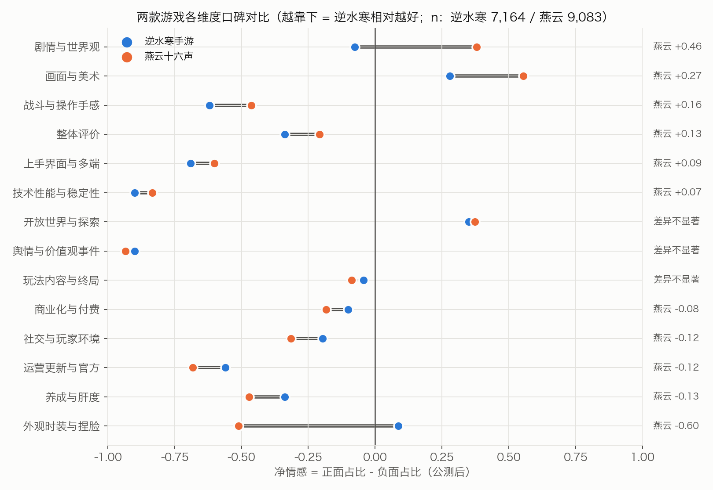
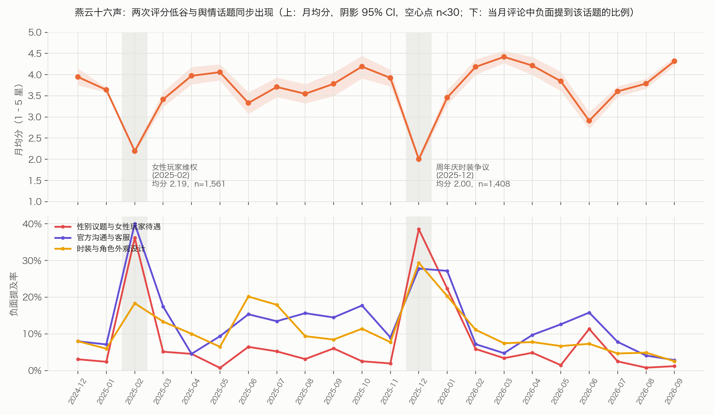

# 《逆水寒手游》vs《燕云十六声》：TapTap 玩家评论对比分析（v2）

> 数据：TapTap 玩家评论 19,811 条（两款各约 9,900 条，均带星级），采集于 2026-09-30。
> 方法：星级统计 + 基于 Claude Haiku 5.5 的结构化方面级情感抽取（M2），并在人工金标准上评估。
> 本项目由我独立完成选题、数据采集、维度审定、金标准标注和结论判断，Claude Code 作为 AI 协作者参与编码与分析。
> 所有数字都可以复算；引文后括号中的数字是 review_id。

---

## 一、项目介绍

### 1.1 背景与目标
《逆水寒手游》（网易雷火，2023-06-30 公测）和《燕云十六声》（网易 Everstone，PC 2024-12-27 公测、移动端 2025-01-09 上线）都是国风开放世界武侠游戏，玩家高度重叠，经常被拿来直接比较。本项目要回答三个问题：
1. 两款游戏的整体口碑有什么不同？
2. 玩家在哪些体验维度上满意、在哪些维度上不满，两款游戏的差别在哪？
3. 是什么在拉低评分：产品本身、运营，还是舆情事件？

### 1.2 方法论原则
- **整体态度以星级为准**。星级是玩家亲手给出的整体评价，是整体口碑最可靠的信号；但它不是各个维度上的"标准答案"。
- **文本模型只回答星级回答不了的问题**：在谈哪个维度、对什么不满、在和谁比较。
- **所有"A 比 B 好/差"都给出 95% 置信区间或检验结果**；样本少于 30 的单元格会标注。

---

## 二、数据

| 项目 | 说明 |
|---|---|
| 来源 | TapTap 官方 Web 接口，按默认（"综合"）排序翻页，每款取约 1 万条 |
| 规模 | 逆水寒 9,905 条，燕云 9,906 条；清洗时去重删除 5 条 |
| 字段 | 评论 ID、星级、正文、发布时间、点赞、游玩时长（约 27% 的评论带有时长） |
| 匿名化 | 昵称加盐哈希，原始昵称不进入任何产出 |

**抽样框的局限（重要）**：用内置浏览器对照接口后确认，"综合"排序不是按时间排序，而且不同位置的星级构成差别很大（有的位置只有 3–5 星，有的位置均分 1.4）。因此本样本是"TapTap 综合排序下前约 1 万条评论"，**不是随机样本**。下文所有结论都限定在这个范围内。

---

## 三、清洗与样本口径

### 3.1 清洗
- 两级去重（平台 + ID，以及 平台 + 评论者昵称 + 正文）；同一正文出现 ≥5 次标记为疑似刷屏（146 条）；不足 4 字标记为短文本。只打标记，不删除。
- **时间校正**：原始时间是采集机所在地（澳洲）的本地时间。用接口返回的 `created_time` 逐秒核对确认后，统一转为北京时间。
- **追评**：TapTap 评论可以编辑，正文和星级是最新版本，但时间戳是首发时间。正文中带日期标记的有 144 条（其中多个版本的 69 条），时间趋势按最后一次追评的日期计入。

### 3.2 比较口径
- **主口径：公测后**（逆水寒 7,219 条，燕云 9,188 条）。公测前的预约期评论单独展示。
- **对齐口径 a**：各自公测后的前 6 / 12 个月（同一生命周期阶段）。
- **对齐口径 b**：共同日历窗口 2025-01 至 2026-09（同一市场环境）。

---

## 四、方法

### 4.1 维度体系（两级，13 个一级 + 兜底，31 个二级）
- **自下而上**：分层抽取 1,500 条评论，用 LLM 做开放式"方面—观点"抽取，得到 9,075 对；再用 bge-large-zh 向量化，UMAP + HDBSCAN 聚类，得到 149 个主题簇。
- **自上而下**：对照常见的游戏体验框架进行合并；最后由我审定，审定时做了三处调整：二级维度控制在约 30 个；舆情单列一级；画面与美术单列一级。
- 一级维度：剧情与世界观、开放世界与探索、战斗与操作手感、玩法内容与终局、养成与肝度、商业化与付费、外观时装与捏脸、画面与美术、技术性能与稳定性、上手界面与多端、社交与玩家环境、运营更新与官方、舆情与价值观事件，另设"整体评价"兜底类。每一类都写有定义、包含与排除规则。

### 4.2 结构化抽取（M2）
每条评论输出一个 JSON，字段包括：整体极性（−2 至 +2）、是否反讽、各方面（二级维度 / 极性 / 观点 / **原文引文** / 是否建议 / 是否谈预期 / 预期是否落空），以及竞品比较（对象 / 维度 / 谁更好 / 原文引文）。
- **引文必须是原文的子串**，由代码校验；不通过的条目重试一次，仍不通过则打标记。最终通过率 99.8%（19,773 / 19,810）。
- 模型：Claude Haiku 5.5，Batch 加提示缓存；全量成本 $4.43。

### 4.3 金标准评估
- 按 游戏 × 星级 × 文本长度 分层抽 400 条，我人工标注了 201 条：dev 99 条用于迭代 prompt，test 102 条只在最后评估一次。
- 人机一致性（dev）：我修改了 34% 的模型预标注；其中整体极性改动 13%，方面集合改动 23%，方面极性改动 3%。
- prompt 共迭代 3 版。v2、v3 与 v1 的差异，配对 bootstrap 95% CI 都包含 0，因此全量运行采用 v1。

**test 集上的方法对比（n = 102）**

| 方法 | 一级维度 F1 | 二级维度 F1 | 方面极性 macro-F1 | 评论级三分类准确率 | 评论极性与星级 Spearman |
|---|---|---|---|---|---|
| 词典 + SnowNLP（基线） | 0.651 | — | 0.314 | 0.510 | 0.294 |
| **M2：Haiku 5.5 结构化抽取** | **0.891** | **0.853** | **0.628** | **0.931** | **0.771** |

各一级维度的 F1 在 0.77–1.00 之间，最弱的是舆情（0.77）和社交（0.78）。

---

## 五、分析

### 5.1 整体口碑：公测后均分打平，但分布形状不同

| 口径 | 逆水寒 均分 [95% CI] | 燕云 均分 [95% CI] | 差（逆−燕） [95% CI] | 检验 |
|---|---|---|---|---|
| **公测后（主口径）** | 3.22 [3.19, 3.25] | 3.22 [3.19, 3.25] | −0.00 [−0.05, 0.04] | Mann-Whitney p=0.90 |
| 对齐 a：公测后前 12 个月 | 3.06 | 3.20 | −0.15 [−0.21, −0.09] | p<0.001 |
| 对齐 b：2025-01 至 2026-09 | 3.45 | 3.21 | +0.24 [+0.17, +0.31] | p<0.001 |
| 公测前（预约期，单列） | 3.76 | 4.00 | — | — |

- 在主口径下，两款均分几乎相同；但 5 档星级的分布显著不同（卡方 p<0.001，Cramér's V = 0.21）。燕云差评率 39%，逆水寒 29%；好评率分别是 44% 和 43%。燕云的评价更两极。
- **比较结果依赖口径**：在同一生命周期阶段（各自公测后的第一年），燕云略高；在同一日历窗口，逆水寒高 0.24。后者反映的是逆水寒运营到第三年以后口碑回升，以及燕云在这段时间经历了两次舆情低谷（见 5.6）。
- 预约期评分明显偏高，属于"期待分"，不和公测后混在一起计算。

### 5.2 分维度体验：共同长板是开放世界，共同短板是技术性能
净情感 = 正面占比 − 负面占比，统计口径为公测后、非短文本、非刷屏的评论。

*图 1：各维度净情感对比。连线越长，两款差距越大；灰色表示差异不显著。*

| 维度 | 逆水寒 净情感 [CI] | 燕云 净情感 [CI] | 差（燕−逆）是否显著 |
|---|---|---|---|
| 开放世界与探索 | +0.35 [0.31, 0.39] | +0.37 [0.34, 0.41] | 否 |
| 画面与美术 | +0.28 [0.24, 0.32] | **+0.55** [0.52, 0.59] | 是，+0.28 |
| 剧情与世界观 | −0.08 [−0.12, −0.03] | **+0.38** [0.35, 0.41] | 是，+0.46 |
| 外观时装与捏脸 | **+0.09** [0.04, 0.14] | −0.51 [−0.55, −0.47] | 是，−0.60 |
| 养成与肝度 | −0.34 | −0.47 | 是，−0.13 |
| 技术性能与稳定性 | −0.90 [−0.91, −0.88] | −0.83 [−0.86, −0.81] | 是，+0.07 |
| 运营更新与官方 | −0.56 | −0.68 | 是，−0.12 |
| 舆情与价值观事件（提及率） | 7.7% | **20.6%** | 提及率差异大；两款提及时几乎都是负面 |

- **共同长板：开放世界与探索**。两款都为正，而且没有显著差异。例：「游戏存在一个单人世界，这里你的进度是自己的」(43670639)。
- **共同短板：技术性能**。两款提及率都在 27–36%，净情感约 −0.9。例：「每次玩游戏手机烫得跟快要爆炸似的」(42447162)；「每次更新玩家都给你当bug检测员」(45859847)。
- **燕云的优势在叙事和画面**：「剧情都很好，文化很用心」(47260924)；「剧情CG做的很精细」(43743900)。逆水寒的剧情净情感接近 0，负面集中在过场动画和题材偏离："本作背景是宋代架空故事，但是已经出现了很多科幻、奇幻元素"(46783591)。
- **逆水寒的优势在外观和捏脸**：「优秀的捏脸体系和量大价低的服装」(39850199)。燕云的外观负面，一部分是设计品质问题（「实装后色差严重，动态表现僵硬」，44017807），另一部分和舆情事件交织在一起（见 5.6）。

### 5.3 什么让玩家打低分
比较 1–2 星评论与 4–5 星评论中，各维度的负面提及率差了多少：

| 游戏 | 低星与高星差距最大的维度（低星 vs 高星 负面提及率） |
|---|---|
| 燕云 | 运营与官方 45% vs 6%；舆情与价值观 43% vs 4%；外观 23% vs 7% |
| 逆水寒 | 运营与官方 34% vs 8%；技术性能 40% vs 24%；剧情 20% vs 7% |

- 两款游戏都是**"运营与官方沟通"最能区分低星和高星**。也就是说，低分更多来自对官方的不满，而不只是产品功能本身。例：「做了错事就随便塞几个绑玉代金券搪塞过去」(44406804)。
- **解读时要注意**：在 TapTap 上，打低分本身就是玩家向官方表达不满、维权的一种方式，所以低星评论天然更容易提到运营和舆情。这个结果说明的是「低星评论在说什么」，不等于运营问题比玩法问题更重要（见第九章第 6 条）。
- 燕云低星评论的第二个特征是舆情。逆水寒的技术性能负面在高星评论里也很常见（24%），说明玩家虽然抱怨，但并不因此给出低分。

### 5.4 不同游玩时长玩家的评价差异
游玩时长是评论时 TapTap 记录的时长，约 27% 的评论带有这个字段，而且 PC 端时长可能记录不全。这是横截面数据，不同时长档是不同的玩家，**不能解读为"玩得越久越不满意"**。为了排除"评论发表时期"的干扰，按公测后 0–2 月、3–11 月、12 月以后三个时期分层。

| 时期 | 燕云：1–10h → 200h+ 差评率 | 逆水寒：<1h → 200h+ 差评率 |
|---|---|---|
| 开服 0–2 月 | 20% → 54% | **48%** → 28% |
| 3–11 月 | 7% → 23% | 20%（n=5，样本过小） → 27% |
| 12 月以后 | 8% → **47%** | 32%（n=34） → 26% |

- **燕云：长时长玩家的差评率在三个时期都明显更高**，所以这不只是开服期的特殊效应。长时长玩家的抱怨集中在终局内容和养成：「到目前为止我觉得真的一点玩头都没有了」(44065421)。
- **逆水寒：<1h 玩家的高差评率主要出现在开服头两个月**。拆解 54 条 <1h 差评：78% 发布于公测头两个月；提及卡顿发热的占 26%，服务器排队的占 22%，新手引导与界面的占 22%（一条评论可以同时提多点）。例：「一上来排个半个小时一个小时是要干什么？」(36487549)；「半个屏幕全是技能」(36486945)。也就是说，开服期的技术容量问题和新手引导问题大致各占一半。

### 5.5 竞品比较：玩家怎么拿对方比较
只统计评论中明确比较优劣的语句，剔除评价对象是本作自己、或对象不明的条目。

| 评论区 → 被比较的游戏 | 提及评论数 | "本作更好"占比（只算分出胜负的）[95% CI] |
|---|---|---|
| 燕云 → 逆水寒 | 246 | 57% [50%, 63%] |
| 逆水寒 → 燕云 | 74 | 39% [28%, 52%] |
| 逆水寒 → 一梦江湖 | 184 | 31% [24%, 38%] |
| 逆水寒 → 原神 | 159 | 25% [18%, 33%] |
| 燕云 → 原神 | 187 | 50% [41%, 59%] |

- 燕云评论区拿逆水寒做参照的，大约是逆水寒评论区拿燕云做参照的 3 倍。总体略偏向"燕云更好"，但接近持平。
- 分维度看，燕云在**剧情**（41 次比较中 83% 认为燕云更好）和**画面**上占优；逆水寒在**外观**和**玩法内容**上占优。但这几个单元格的有效比较都不到 30 次，只作方向参考。
- 逆水寒的玩家更常拿老牌 MMO（一梦江湖、天涯明月刀）和原神来比，而且多数认为对方更好。比较的焦点主要是玩法和商业化。

### 5.6 时间趋势：燕云的两次低谷都与舆情事件同期
按季度看，以追评修正后的时间计。下图是燕云的月度时间线。

*图 2：燕云月均分（上）与三类负面话题的提及率（下）。两次低谷时，性别议题和官方沟通的提及率同时冲高到平时的 3–4 倍。*

| 低谷 | 评论数 | 均分 | 差评率 | 和其他月份相比明显多出来的话题 |
|---|---|---|---|---|
| 燕云 2025-02 | 1,561 | 2.19 | 81% | 官方沟通 40%（其他月份 12%）；性别议题 36%（10%） |
| 燕云 2025-12 | 1,408 | 2.00 | 84% | 性别议题 39%（10%）；时装设计 29%（10%） |

- 2025-02 的低谷与媒体报道的燕云女性玩家维权同期（[36氪，2025-02-24](https://www.36kr.com/p/3179990014660740)）。2025-12 的低谷与周年庆时装争议同期（[DoNews](https://www.donews.com/news/detail/3/6336972.html)）。高赞差评例：「情人节官方卖点拿红线做噱头」(43743900)；「官方搞这样一套设计低俗的衣服」(47270523)。
- 两次低谷之后的季度均分都回升到 3.8–3.9。这些低谷更像事件驱动的评分潮，不代表产品体验的持续下滑。不过，这类评论确实计入了平台评分。
- 逆水寒的季度均分从公测当季的 2.37 回升到 2026Q1 的 4.25，之后在 2026Q2 回落到 3.12（原因未展开）。

### 5.7 期望差
两款都有 12–14% 的评论在谈预期，其中预期落空的约占 85%（逆水寒 86% [84%, 89%]，燕云 85% [83%, 87%]），**差异不显著**。预期落空评论的均分约 2.3，预期符合的约 4.5。

---

## 六、结论
1. **整体口碑没有绝对的高下**。公测后两款均分打平（3.22 vs 3.22）。燕云评价更两极，差评率高 10 个百分点；比较结果还会随对齐口径而翻转。
2. **共同长板是开放世界与探索，共同短板是技术性能**。差异化方面：燕云赢在剧情和画面，逆水寒赢在外观和捏脸。
3. **拉低评分的首要因素是对官方运营与沟通的不满**，这一点两款都如此。燕云还叠加了舆情与价值观事件：2025-02 和 2025-12 的两次评分低谷都与之同期。
4. **不同时长玩家的评价差异**：燕云长时长玩家的差评明显更多，并且在不同时期都成立，指向终局内容和养成的问题；逆水寒短时长玩家的差评主要集中在开服期，技术容量和新手引导的问题大致各占一半。

## 七、建议
- **燕云十六声**
  - 短期：建立舆情事件的回应机制。两次低谷的诉求都集中在"官方沟通"和"性别议题"，外观设计上线前可以增加针对女性玩家的评审环节。
  - 中期：补充终局内容和长期目标，回应 50h+ 玩家的流失风险。
  - 长期：守住剧情和画面这两个对竞品的相对优势。
- **逆水寒手游**
  - 短期：修复技术性能问题（发热、卡顿），这是提及率最高的负面维度。今后的大版本和新服，要预留服务器容量并简化前期 UI。
  - 中期：改善运营沟通和补偿方式，因为这是区分低星和高星最明显的维度。
  - 长期：继续放大外观和捏脸的优势；剧情方面需要回应题材偏离的质疑。

## 八、方法论复盘：从词典法到结构化抽取
| 问题 | 证据 | 新做法 | 提升 |
|---|---|---|---|
| 维度词和情感词重叠，结论可能是方法自己造出来的 | "沉浸、探索"同时在正向词典里，"闪退、卡顿"同时在负向词典里 | 维度和极性由同一个模型在上下文中判断，并附原文引文 | 一级维度 F1 从 0.65 提到 0.89 |
| 句级情感没有区分度 | 57% 的句子一个情感词都没命中；1 星评论中 33% 被判为正面 | 评论级和方面级极性都由 LLM 判断，并用金标准评估 | 评论级三分类准确率从 0.51 提到 0.93，与星级的相关从 0.29 提到 0.77 |
| 词典规则有 bug | 单字误伤（"数值"被判正面）；否定词整句翻转（"不是不好玩"被判负面） | 不再依赖词典 | 方面极性 macro-F1 从 0.31 提到 0.63 |
| 预约期评论混入整体口碑，时间窗口错位 | 预约期占逆水寒样本 27%，均分 3.76 | 主口径改为公测后，另做两种对齐口径 | 口碑差异的来源被拆清楚了 |
| 时区和追评导致时间错位 | 澳洲本地时间被当作 UTC 处理，645 条评论的月份归错 | 时区按接口逐秒核实；追评日期重建 | — |
| 没有评估体系 | 原来无法回答"准不准" | 人工金标准 201 条；dev / test 分离；记录人机修改率 | 有了可复核的指标 |

## 九、局限
1. **抽样框**：样本是"综合"排序下的前约 1 万条，不是随机样本；排序算法本身影响星级构成。
2. **金标准**：只有 201 条，大多数一级维度在 test 中不足 30 条，逐类指标的置信区间较宽。我是在模型 v1 预标注的基础上修改的，存在锚定效应，v1 的指标可能偏高。
3. **模型噪声**：同一 prompt 运行两次，结果之间的一致性约为 F1 0.89。
4. **时间**：星级是当前值，时间是首发时间（追评只能部分修正）；游玩时长约 27% 的评论才有，而且 PC 端可能记录不全。
5. **因果**：本文都是相关性描述。时长分层是横截面比较，存在幸存者偏差。舆情低谷与事件同期，但两者的因果关系没有经过检验。
6. **差评的「维权属性」**：在 TapTap，差评本身就是玩家向官方施压、维权的渠道。舆情事件期间，大量玩家集中打低分来表达立场，所以低星评论中运营和舆情话题偏多，在一定程度上是这种使用方式必然带来的结果。这可能掩盖玩法、内容上真正需要优化的问题：这些问题往往出现在 3 星或高星评论的「建议」里，而不是在低星评论里。后续可以单独分析中评（3 星）和带建议（`is_suggestion`）的方面，或者剔除事件月份后重算 5.3。
