# Olist 巴西订单与物流体验分析

> **从相关到因果，从指标到决策。** 数据是 Olist 公开数据集：9 张关联表、99,441 笔订单，下单时间 2016-09 至 2018-10，主要分析窗口 2017-01 至 2018-08。
> 所有数字都可以由 SQL（DuckDB）和 Python 脚本一键重新跑出来。效应量一律附 95% 置信区间；凡是因果表述，都写明了识别假设。

---

## 业务版摘要

**背景**：Olist 是巴西的电商平台，帮数千家小商家卖货、发货。我们分析了它约 10 万笔订单，想弄清三件事：快递晚到会让顾客多不满意？晚到该怪谁？该怎么改？

**三个发现**

1. **晚到的订单，差评率是准时订单的近 7 倍（62% vs 9%）。而晚到订单的差评里，约九成是顾客"还没收到货"时写的。** 平台的评价邀请大约在承诺送达日后两天发出，货晚了的顾客，往往是在苦等中被邀请打分，于是把等待的焦虑直接写进了差评。

2. **顾客最在意的是"说好的日子没到"，而不只是"慢"。** 同样是收到货以后才评价，"刚好比承诺晚 1 天"比"刚好按时"的差评明显多；这一下的打击，大致相当于整体慢了两周。但顾客会不会再回来买，主要还是看快不快。

3. **晚到主要卡在快递运输环节，而不是商家发货慢**：约七成的晚到，商家都按时发了货。而且问题高度集中在少数几条路线上，光"圣保罗 → 里约"一条路线就占了全部晚到的 17%。另外，差评里只有约四成和物流有关，**另外四成多是商家发错货、少发货或商品质量问题**，这一块同样值得管。

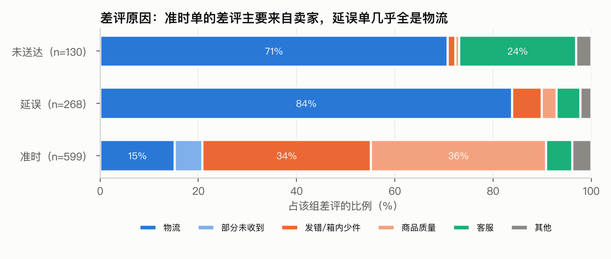

**五个建议（按优先级）**

| 优先级 | 做什么 | 为什么 | 怎么验证 |
|---|---|---|---|
| 优先 | **预计会晚到时，主动告诉顾客**，给出新的到货时间和退款入口；评价邀请等货到了再发 | 晚到订单的差评约九成写于收到货之前 | 一半延误订单发通知、一半不发，对比差评率；如果效果在 10 个百分点左右，约 2 个月能出结果 |
| 优先 | **按路线、按月动态调整承诺送达时间** | 现在的承诺是"一刀切"，快递突然变慢的月份（如 2018 年 3 月）会大面积失约 | 一部分路线先试行，确保差评率不上升 |
| 重要 | **管住商家的"发错、少发"**：多件订单出库核对，按差错率给商家分级 | 这类问题占差评的两成多，和晚到一样大 | 一半商家先启用，约 2 个月看效果 |
| 重要 | **重点治理问题路线的快递**，从圣保罗 → 里约开始 | 一条路线就占全部晚到的 17%；单靠调整承诺解决不了 | 两家快递分流对比 |
| 重要 | **同一商家的多件商品按一个包裹收运费** | 现在基本是一件收一次运费，顾客可以少付约四成 | 小范围试行，看顾客是否更愿意一次买多件 |
| 长期 | 在偏远地区招募本地商家 | 偏远地区运费贵，九成是因为距离远 | 先在一个州试点 |

**需要说明的局限**：数据只记录了"已经下单"的顾客，看不到因为承诺时间太长而放弃购买的人，所以和"下单转化"相关的效果，都需要通过上线试验来确认。

---

## 0. 摘要

| | 发现 | 证据 |
|---|---|---|
| 1 | 延误订单差评率 **62.4%**，准时订单 **9.3%**（6.7 倍）。延误带来的差评差距中，约 **81% 来自"等待期差评"**：货还没到，买家已经在抱怨超时或收不到；另外 19% 写在收货之后。两部分都是物流问题，但机制和对策不同 | 统一口径 + 评价时间分解；LLM 文本分类结果与之相符（延误且收货前作答的差评中 81.2% 在说"没收到"，这是另一个量，只能算佐证） |
| 2 | 只看收货后才评价的订单，断点回归估计**越过承诺日伴随差评率上升 5.9 pp（95% CI 2.4–9.3）**，加入协变量后为 4.3 pp（0.9–7.7），点估计约等于配送慢 12–16 天的效应；延误之后再多晚几天，没有检出额外影响。"用户惩罚违背承诺而非绝对慢"的方向**得到支持性证据**，但评分对"慢"本身也敏感（+0.37 pp/天） | 断点回归（密度与协变量平衡检验没有通过，降级为支持性证据，不作因果结论） |
| 3 | 复购呈现不同的模式（观察性证据）：复购率随配送天数下降（每天 −0.036 pp，CI −0.056 到 −0.015）；控制配送天数后，越过承诺日**没有检出**对复购的额外影响（+0.22 pp，CI −0.53 到 0.97，区间较宽）。首单送达后 180 天复购率只有 1.75%，一次延误的复购损失约 R$0.64 | 复购 logit（控制可观测变量，假设无遗漏混杂） |
| 4 | 延误主要发生在**承运环节**：卖家超时只占超时天数的 14.5%；**4 条线路贡献了一半的延误**，SP→RJ 一条就占 17.6% | 逐单精确的归因恒等式 |
| 5 | 平台承诺在总体上**已经接近静态最优**：延误率不变时，按线路校准只能缩短约 1 天。价值主要在**动态**调整：2018 年 3 月承运冲击期间，延误率能比现状低 5.6 pp | 样本外模拟（2017 年训练，2018 年测试） |
| 6 | 物流只占差评的 **41–44%**，卖家侧（发错或箱内少件、商品质量）占 **45%** | 1,000 条评论用 LLM 分类 + 人工核验，κ = 0.75 |
| 7 | 运费由**起步价（44%）、距离、重量**决定。furniture_decor × RJ 的 40.88% 是低单价造成的，不是物流贵；同一卖家的多件订单**按件收运费**，改成按一个包裹计价，买家可以少付 38% | 运费回归 + 模拟 |

**5 条建议**（第 9 章）：P0 是延误主动沟通、动态线路承诺；P1 是卖家履约准确度、重点线路承运治理、多件订单合并计价；P2 是偏远地区本地卖家。

---

## 1. 项目概览

### 1.1 背景
Olist 是巴西的电商服务平台，把数千家中小商家的商品统一上架到各大电商渠道，并承接订单、物流和售后。巴西幅员辽阔、卖家高度集中在 SP，所以时效和运费是体验的核心变量。

### 1.2 业务问题
- **Q1 时效与满意度**：送货慢会不会导致低分，甚至不再复购？用户惩罚的是"慢"还是"违约"？
- **Q2 配送经济性**：哪些地区和品类的运费负担最重？驱动因素是什么？
- **Q3 从指标到决策**：延误该归责于谁？承诺应该怎么定？差评里物流占多大比例？每条建议的影响有多大，该怎么验证？

---

## 2. 数据底座

### 2.1 建模
DuckDB 以只读方式挂载原始 SQLite 库（`Olist.db`）。原表的数值列里混有空串，统一先以 VARCHAR 读入，在 staging 层再显式转换类型。

| 层 | 文件 | 关键决策 |
|---|---|---|
| staging | `01_staging.sql` | 地理坐标先剔除巴西国境外的点，再按邮编取均值；一单多评取最新一条；支付按单聚合，主要支付方式取金额最大的那种 |
| 明细宽表 | `02_dw_order_item_wide.sql` | 112,650 行；新增卖家坐标、**haversine 球面距离**、线路（卖家州 → 买家州）、是否同州 |
| 订单宽表 | `03_dw_order_wide.sql` | 99,441 行；新增 `delay_days`（断点回归的驱动变量）、卖家环节和承运环节时长、是否超过 `shipping_limit`、评价时间、是否收货前作答、顾客订单序号和首单标记、时效样本标记 `in_timing_sample` |

**数据测试**（17 项全部通过）：
- 主键唯一；
- 行数和原始表一致；
- **两张宽表的 GMV 和运费逐分对账**；
- 每单只有一条评价；
- `is_delayed` 只在时效样本内取值，并且和 `delay_days` 一致；
- 每位顾客恰好有一个首单；
- 时间异常订单共 189 单；
- 关键字段的缺失率不超过设定阈值。

### 2.2 口径

| 指标 | 分母 | 数值 | 说明 |
|---|---|---|---|
| 延误率 | 时效样本：已交付、时间戳完整、非异常，共 96,282 单 | **6.78%** | 送达**日期**晚于承诺**日期**算延误，承诺当天送达算准时 |
| 差评率（1–2 星） | 有评分订单 98,673 单 | **14.69%** | 无评分的 768 单不计入 |
| 延误 / 准时差评率 | 时效样本 ∩ 有评分 | **62.41% / 9.26%** | 分母不含无评分订单（延误订单无评分的比例更高，混入会稀释差距） |
| AOV | 有商品明细的订单 | R$137.75 | 不含 775 单无商品明细的订单 |
| 运费占比 | 有商品明细的订单 | **加权 16.57%**；简单平均 30.84%；中位数 22.44% | 加权口径回答"每 R$1 货值买家多付多少运费"，简单平均回答"典型一单的负担感"。运费是**买家支付的**，不是平台成本 |

**时间异常订单**（189 单，指发货早于下单，或送达早于发货）统一处理为：从时效类指标中剔除，规模类指标保留。剔除前后，平均配送天数只从 12.497 变成 12.507。

---

## 3. 经营基线

| KPI | 数值 |
|---|---|
| Product GMV（不含运费，全部订单状态） | R$13.59M |
| 订单量 | 99,441 |
| AOV | R$137.75 |
| 平均评分 | 4.086 |
| 平均配送天数 / 平均承诺天数（时效样本） | 12.51 / 24.37 |
| 已交付占比 | 97.02% |

- **增长**：2018 H1 和 2017 H1 相比，GMV 增长 **176.1%**。之所以用上半年同比，是因为 2016 年只有平台起步期的 329 单，滚动 12 个月的增长率会被低基数放大。
- **AOV**：2017-03 之后的月度 AOV 在 R$125–147 之间波动，整体稳定，没有趋势性变化。
- **地区**：SP、RJ、MG 三州贡献了全平台 60% 以上的 GMV，卖家同样集中在 SP。这是后面"偏远地区又慢又贵"的结构性原因。

---

## 4. 时效与满意度

### 4.1 描述性事实
| | 订单 | 平均评分 | 差评率 | 5 星率 |
|---|---|---|---|---|
| 准时 | 89,258 | 4.291 | 9.26% | 62.3% |
| 延误 | 6,379 | 2.271 | 62.41% | 16.6% |

评分随配送天数单调下降：0–5 天 4.44 分，35 天以上 1.94 分。但这条"剂量—效应"曲线**不能直接当作因果证据**，原因见 4.3。

### 4.2 等待期差评：延误差评的主体

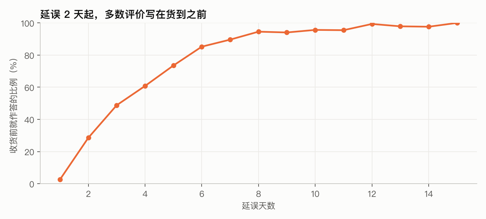

Olist 的满意度问卷：准时订单在送达后第二天发出，延误订单在承诺日后约 2 天发出，不管货到没到。所以：

| | 延误订单 | 准时订单 |
|---|---|---|
| 在收货前作答的比例 | **70.1%**（68.9–71.1） | 0.2% |

- 延误订单中，**收货前作答的差评率是 80.7%，收货后作答的是 19.4%**。
- 换个角度：延误订单的差评中，**90.7% 写于收货之前**。
- 延误和准时之间 53.1 pp 的差距里，**80.9%（77.7–83.9）来自收货前作答**。
- 这些评价写的是什么？阶段 7 的文本分类显示，延误且收货前作答的差评中，**81.2% 在说"还没收到货"**；人工核验的 25 条中，92% 是物流问题。（这与上面的 80.9% 是两个不同的量，数值接近只是佐证，不是独立复现。）
- 口径说明："收货前作答"用 `review_answer_ts < delivered_ts`（买家作答时间）。宽表中另有 `review_before_delivery`（问卷**发出日**早于送达日），延误订单中这一比例是 74.4%；第 4 章统一使用前者。
- **定性**：这是真实的物流失败带来的"等待期差评"，**不是测量上的伪差异**。区分送达前和送达后，不是为了把等待期差评剔除掉，而是因为两段的机制不同，对策也不同：等待期要靠主动沟通，收货后要靠提速和承诺管理。

> 说明：这里的分解是会计意义上的拆分。收货后才作答的延误订单是一个被筛选过的人群（愿意等到收货才回答），所以"19.4%"可能偏低。

### 4.3 因果分析：违背承诺 vs 绝对慢

**分层对比**（在同一配送天数档内，比较延误与准时的差评率）：

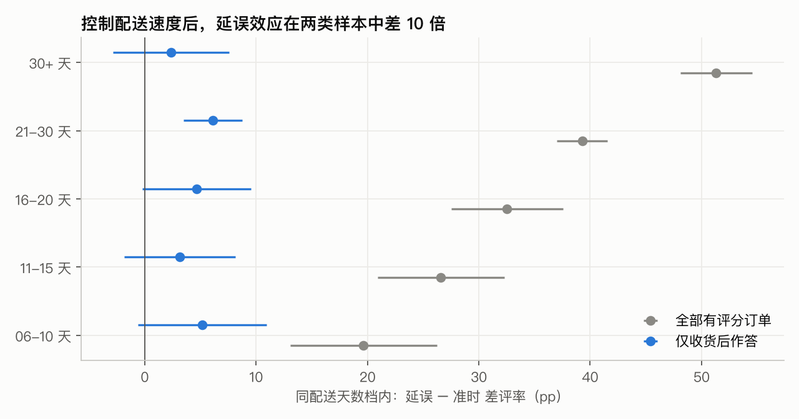

| 样本 | 按延误单数加权的组内差距 |
|---|---|
| 全部有评分订单 | +44.1 pp（42.2–46.0） |
| 只看收货后作答 | **+4.8 pp（2.9–6.8）** |

**断点回归**：驱动变量是"实际送达日 − 承诺日"，断点在 0 和 1 之间；局部线性，三角核，同时报告 HC1 和按天聚类两种置信区间，取较宽的那个。

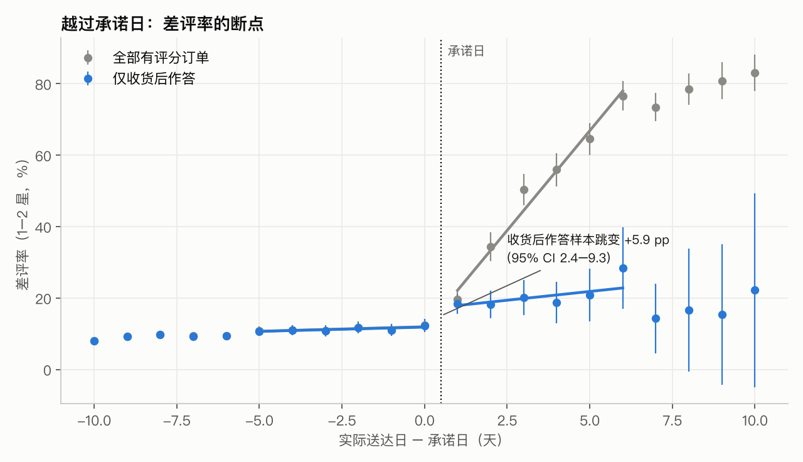

| 收货后作答样本 | 断点处跳变 |
|---|---|
| 差评率（带宽 5 天） | **+5.9 pp（2.4–9.3）**，断点左侧约 12% |
| 平均分 | −0.29（−0.41 到 −0.17） |
| 加入协变量（承诺天数、距离、价格、州、月份） | **+4.3 pp（0.9–7.7）** |
| 带宽 2 / 3 / 4 / 5 / 7 / 10 天 | 5.4 / 5.6 / 5.8 / 5.9 / 5.7 / 5.9 |
| 二次多项式 / 剔除承诺当天（donut） | 6.0 / 6.7 |
| 安慰剂断点（−4.5 到 +3.5 共 6 个） | 置信区间全部包含 0 |

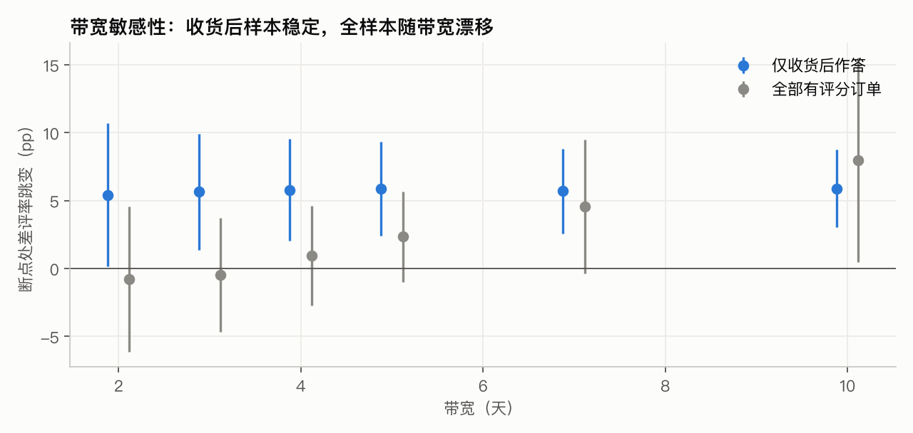

**识别假设**：除"是否延误"以外，影响评分的其他因素在承诺日两侧连续变化，且送达时间不能被精确地操纵到承诺日的某一侧。检验结果：

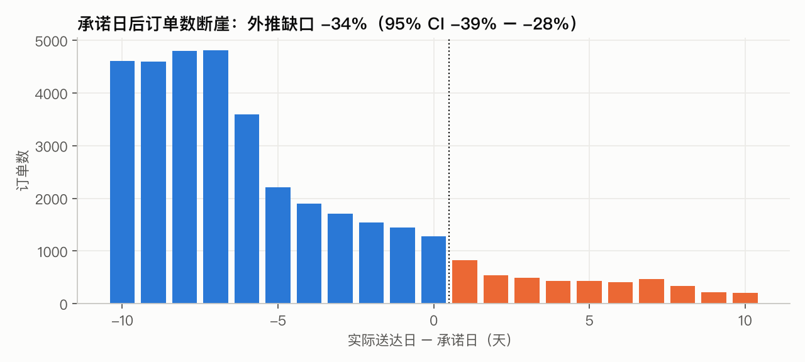

- **密度检验没有通过**：承诺日之后订单数出现断崖，外推缺口为 −34%（−39% 到 −28%）。很可能是承运方在"赶在承诺日之前送到"。
- **协变量不平衡**：刚好延误的订单，承诺天数多 2.5 天（1.5–3.5），距离约远 24%；价格和运费占比是平衡的。
- **单协变量粗略调整（不是偏差上界）**：多出的 2.5 天 × "绝对慢"的斜率 0.37 pp/天 ≈ 0.9 pp，只修正了承诺天数这一项；距离的不平衡（约远 24%）和密度检验揭示的选择（哪些订单被"赶"在承诺日之前）无法用它界定，偏差方向也无法确定。加入协变量后估计从 5.9 降到 4.3 pp（0.9–7.7）。
- **定性**：断点回归只能作为**支持性证据**。表述为"断点回归估计越过承诺日伴随差评率上升，主估计 5.9 pp（2.4–9.3），协变量调整后 4.3 pp（0.9–7.7）"，不写成确定的因果效应。
- 全样本的断点估计不可靠，从 −0.8 到 +8.0 pp 随带宽漂移。原因是从晚 2 天开始，收货前作答的比例急剧上升，断点右侧的斜率被样本构成主导。

**回归**：差评 ~ 配送天数样条 + 是否延误 + 延误天数 + 距离 + 价格 + 运费占比 + 件数 + 品类、州、月份固定效应。

| 效应（平均边际效应） | 全部有评分订单 | 只看收货后作答 |
|---|---|---|
| 是否延误（logit） | +24.4 pp（22.5–26.4） | **+2.3 pp（0.7–3.9）** |
| 是否延误（线性概率模型 + 卖家固定效应） | +35.8 pp（33.9–37.7） | +4.2 pp（1.9–6.5） |
| 延误后每多晚 1 天 | +0.60 pp（0.50–0.70） | +0.08 pp（−0.21 到 0.38），不显著 |
| **准时订单每多 1 天配送（"绝对慢"）** | **+0.37 pp（0.34–0.41）** | 同左 |
| 有序 logit：延误对 5 星概率的影响 | −39.2 pp | **−7.2 pp（−9.5 到 −4.8）** |

- 加入卖家固定效应后，系数几乎不变（34.9 → 35.8），说明**不随时间变化的卖家差异**不是主要的混杂；随时间变化的卖家状况（例如某段时间缺货或人手不足）无法由此排除。
- 黑五等高峰期和延误的交互项不显著。
- 延误对 5 星的损失，比对差评的增加更大：很多人没打差评，只是不再给 5 星。

**结论**：

| | 效应 |
|---|---|
| 违背承诺（越过承诺日这一跳） | 差评率 +5.9 pp（2.4–9.3）；协变量调整后 +4.3 pp（0.9–7.7）（断点回归，收货后样本，支持性证据） |
| 绝对慢 | +0.37 pp/天（0.34–0.41） |
| 两者之比 | 越过承诺日一次 ≈ 慢 **12–16 天**（按 4.3 或 5.9 pp 计；只是点估计之比，不确定性很大：用主估计的置信区间算是 6.5–25 天） |
| 延误后的剂量效应 | 收货后样本中每多晚 1 天 +0.08 pp（−0.21 到 0.38），没有检出剂量效应 |

### 4.4 差评原因构成（轻量 LLM 分类 + 人工核验）

从 10,840 条有文字的 1–2 星评论中抽取 1,000 条，用 Claude Haiku 5.5 分为 6 类，总花费 $0.134。作者对其中 99 条做了盲评核验：一致率 **80.8%**，**Cohen's κ = 0.75**（0.64–0.83）。分歧集中在"买 2 个只来 1 个"这类评论该归"部分未收到"还是"漏发"；按核验结论校正：单卖家订单归为漏发。


| 类别 | 全部 | 准时 | 延误 | 未送达 |
|---|---|---|---|---|
| 物流 | **40.9%**（37.9–44.0） | 15.2% | **84.0%** | 70.8% |
| 部分商品未收到 | 3.4% | 5.7% | 0% | 0% |
| 发错或箱内少件 | **22.3%** | 34.2% | 6.0% | 1.5% |
| 商品质量 | **22.5%** | 35.7% | 3.0% | 0.8% |
| 客服 | 7.6% | 5.3% | 4.9% | **23.8%** |

- **物流改善的天花板 ≈ 差评的 41–44%。**
- **卖家侧（发错或箱内少件 + 商品质量）占 45%**，是和物流同等量级的抓手。
- 未送达订单中客服问题占 24%：买家等不到货，转而投诉退款和取消流程。
- 局限：样本只包括有文字的差评（约占全部差评的 75%）；只有作者一人做了核验。

---

## 5. 延误归因与卖家责任

### 5.1 归因恒等式
以承诺日当天 24:00 作为截止时间（deadline），**每单都精确成立**（最大误差 3×10⁻¹⁴ 天）：
```
延误 = 卖家超时（交承运时间 − shipping_limit）
     + 承运超时（承运实际用时 − (deadline − shipping_limit)）
```

| 延误单类别 | 占比 | 平均延误 | 差评率 |
|---|---|---|---|
| 只有承运超时 | **72.2%** | 10.6 天 | 62.1% |
| 两者都超时 | 15.3% | 12.1 天 | 67.7% |
| 只有卖家超时 | 12.4% | 6.3 天 | 57.5% |

- 卖家超时只占正向超时天数的 **14.5%**。
- **反事实**：假设所有卖家都按时交给承运方，延误单只减少 **12.4%**（延误率从 6.78% 降到 5.94%）。
- "承运超时"无法区分是承运方慢了，还是承诺本身定得太紧，这正好引出第 6 章的承诺校准。

### 5.2 线路与时间
- **410 条线路中，4 条覆盖了 50% 的延误单，21 条覆盖了 80%。**
- **SP→RJ** 只有 441 km，延误率却是 14.2%（SP→MG 是 5.3%），一条线路占全部延误的 17.6%；其中 94% 的延误单有承运超时。
- 2018 年 2–3 月延误率达到 14–19%，是平常的 3–5 倍，80–85% 是承运超时，属于全平台范围的承运冲击。

### 5.3 卖家帕累托
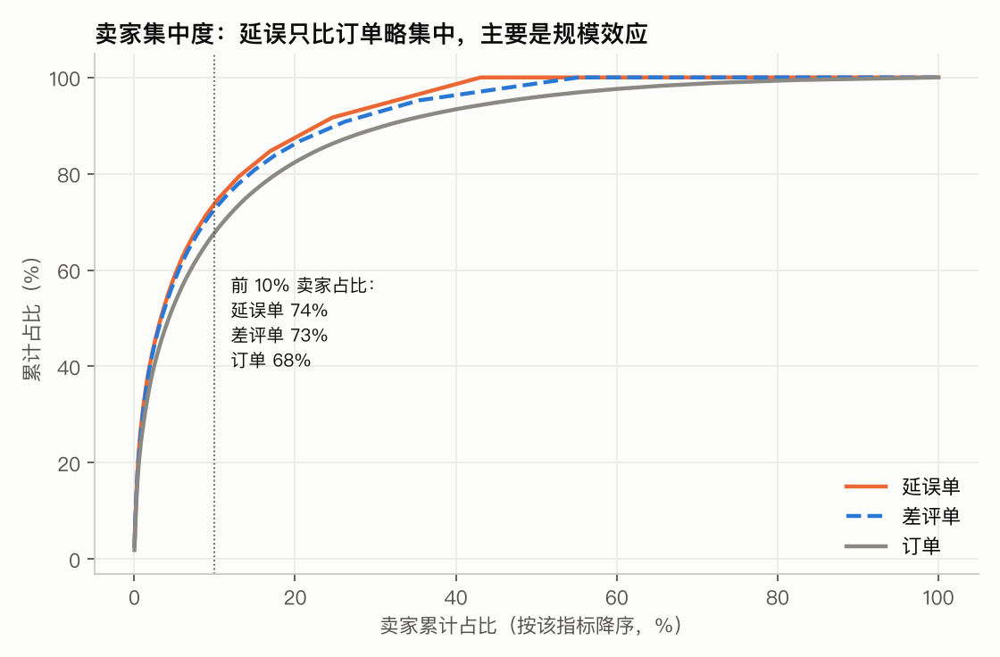

- 前 10% 的卖家贡献了 74% 的延误和 73% 的差评，但他们本身就占约 63% 的订单（按延误单数排序时），所以**集中度主要是规模效应**。
- 只看单量 ≥ 30 的卖家，按延误率分成十组：最差的一组延误率 16.7%，贡献 15% 的延误，占 6% 的订单。
- **新卖家**（首单后 90 天内）的延误率和差评率并不比老卖家高（6.1% vs 7.0%），数据不支持针对新卖家设门槛。

### 5.4 可执行规则
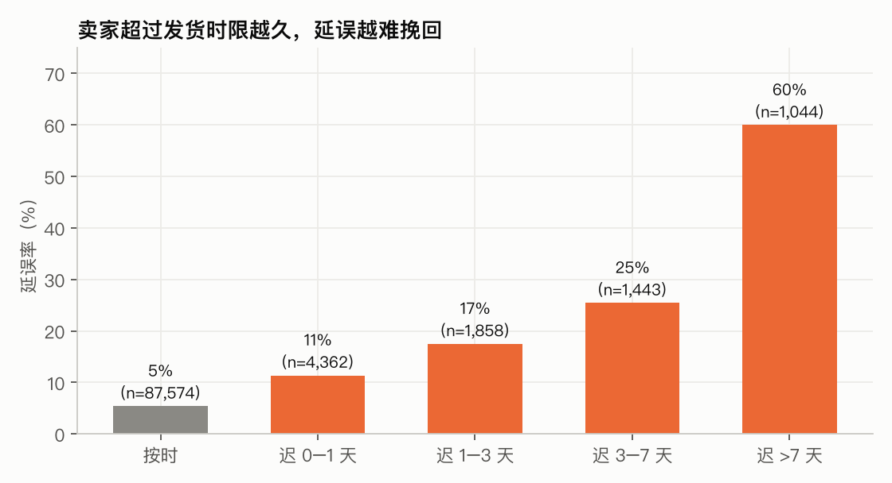

| 规则 | 标记订单占比 | 覆盖的延误单 | 被标记订单的延误率 | 提前量 |
|---|---|---|---|---|
| **R1 实时**：到了 `shipping_limit` 还没交给承运方 | 9.0% | **27.8%** | 20.8%（未标记的是 5.4%） | 中位数 **16 天** |
| R2 卖家画像：历史迟发率 ≥ 20% 且历史单量 ≥ 10 | 10.4% | 15.9% | 10.3%（提升度 1.52） | — |

R1 的价值不在于让卖家补救，而在于**提前约 16 天识别高风险订单**，可以用来触发建议 1 的主动沟通。

---

## 6. 承诺校准

**样本外设计**：用 2017 年下单的订单估计各线路配送天数的分位数，在 2018-01 至 08 的订单上评估（52,612 单）。承诺天数 = 线路分位数向上取整；线路样本不足时，依次退到买家州、全局（按 P90 计算，96% 的订单用的是线路自己的分位数）。差评率用阶段 2 的 logit 预测：上界用全样本模型，含等待期差评；下界用收货后样本模型。

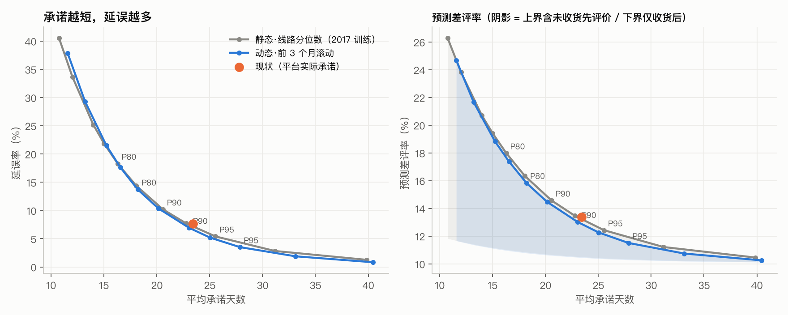

| 策略 | 平均承诺天数 | 延误率 | 预测差评率（上界 / 下界） |
|---|---|---|---|
| **现状** | 23.4 | 7.6% | 13.4% / 10.5% |
| 静态 P90 | 20.6 | 10.2% | 14.6% / 10.7% |
| **动态 P90**（前 3 个月滚动） | 23.0 | **6.9%** | **13.0%** / 10.5% |
| 动态 P80 | 18.2 | 13.7% | 15.8% / 10.8% |
| 承诺定在中位数（动态 P50） | 11.6 | 37.8% | 24.7% / 11.7% |

- **"承诺 24 天、实际 12 天，承诺宽松了一倍"是把均值和尾部混为一谈**：配送天数分布右偏，要守住约 92% 的准时率，本来就需要约 23 天。延误率不变时，静态校准只能缩短 0.6 天，动态校准缩短 1.0 天。
- **动态调整的价值在冲击期**：

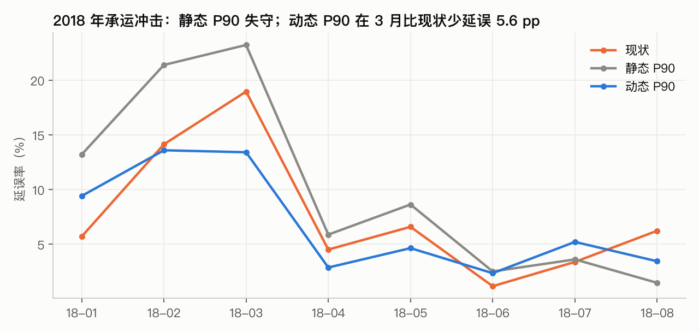

  2018 年 3 月，现状的延误率是 19.0%，静态 P90 是 23.2%，**动态 P90 是 13.4%**。代价是冲击过后承诺仍然偏长（4 月平均 26.4 天）。
- **线路差异化**：PR→SP、SC→SP、RJ→RJ 等线路，现状延误率只有 2–5%，可以收紧 4–9 天；SP→BA、SP→ES 应该放宽。SP→RJ 即使按 P90 定承诺，延误率仍有 14.2%，靠校准救不了，需要承运治理。
- **观测不到、只能作为假设的部分**：①承诺缩短带来的转化提升，数据里只有成交订单；②承运方会对承诺做出反应（密度检验已经显示送达时间在承诺日之前扎堆），本模拟假设实际用时不随承诺变化。

---

## 7. 配送经济性

### 7.1 运费由什么决定
模型（单件订单 88,405 单，OLS，标准误按卖家州聚类，R² = 0.62）：运费 ~ 距离 + 重量 + 体积 + 价格 + 同州 + 品类。

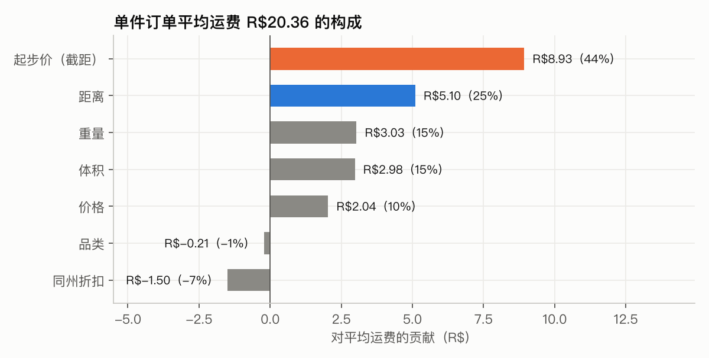

| 变量 | 系数（95% CI） |
|---|---|
| 截距（起步价） | **R$8.93**（5.57–12.29） |
| 每 100 km | +R$0.84（0.66–1.03） |
| 每 kg | +R$1.44（1.00–1.87） |
| 每 10 L 体积 | +R$1.95（1.54–2.36） |
| 同州 | −R$4.18（−4.77 到 −3.59） |

- **运费水平**：起步价占平均运费的 **44%**，距离净贡献 18%（25% 减去同州折扣 7%），重量和体积合计 30%。
- **单与单之间的差异**（Shapley R² 分解）：重量体积 51%，距离 26%，价格 16%，品类 6%。在控制重量和体积之后，品类几乎没有独立作用。

### 7.2 两个常见判断的再检验
- **furniture_decor × RJ（卖家州）40.88%**：从 RJ 发出的家具，运费绝对值（R$17.2）**比 SP 发出的还低**（R$20.3）；模型残差（+1.7）和其他州相当。占比高是因为 RJ 卖的家具单价只有 SP 的一半（R$47.8 vs R$92.7）。按 SP 的价格算，占比只有 18.6%。因此针对"品类 × 卖家州"组合建区域仓缺少依据。
- **北部买家运费高**：

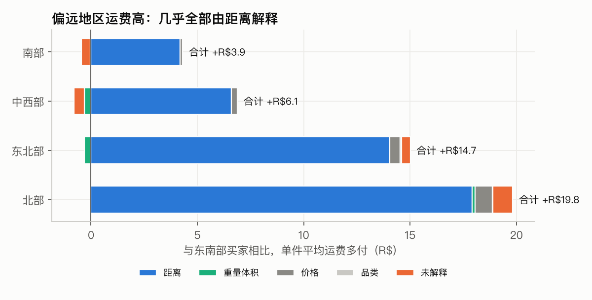

  北部买家比东南部多付 R$19.8，**其中 R$17.9（90%）由距离解释**，重量和价格的贡献可以忽略。

### 7.3 运费和满意度
控制价格和时效后，运费占比每增加 10 pp，差评率 **+0.07 pp（−0.04 到 0.18）**，没有可检出的影响。因此不应把运费占比解读为"侵蚀平台利润"：运费是买家付的，不进平台的利润表；它也不影响已成交订单的满意度。**它真正可能影响的是下单转化，这在本数据中观测不到**。

### 7.4 多件订单合并计价与包邮门槛
| 同一卖家的订单件数 | 平均运费合计 | 平均每件运费 |
|---|---|---|
| 1 件 | R$20.37 | R$20.37 |
| 2 件 | R$36.82 | **R$18.41** |
| 5 件以上 | R$114.34 | R$19.17 |

- 现在**基本按件收运费**。如果按一个包裹计价（用模型预测），这 8.6% 的订单平均少付 **R$17（38%）**，近 12 个月合计约 **R$11.6 万，占 GMV 的 1.1%**。
- 跨订单合并的空间可以忽略：同一买家同一天向同一卖家下多笔订单的，只占 0.7%。
- **包邮门槛**（近 12 个月，不考虑凑单行为）：门槛 R$149 时补贴占 GMV 6.8%，R$199 时 4.8%，R$99 时 10.0%。全面包邮远比合并计价贵。

---

## 8. 满意度 → 复购

复购的定义：同一 `customer_unique_id` 在**首单送达之后**、首单下单后 180 天内又下了一单。送达前下的单、同一天拆开下的单都不算。样本是 2017-01 至 2018-02 的首单，共 55,179 单。

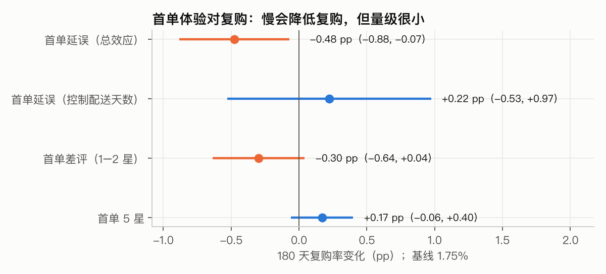

| 首单体验 | 180 天复购率变化（基线 **1.75%**） |
|---|---|
| 延误（总效应） | **−0.48 pp（−0.88 到 −0.07）**，相对降幅约 27% |
| 延误（控制配送天数） | +0.22 pp（−0.53 到 0.97），不显著 |
| 每多 1 天配送 | **−0.036 pp（−0.056 到 −0.015）** |
| 差评 | −0.30 pp（−0.64 到 0.04） |

- **一次延误的代价** = 0.48 pp × 复购者 180 天平均复购 GMV R$134 ≈ **R$0.64**（0.09–1.18）；全年约 R$3,600，占 GMV 的 **0.03%**。
- 和第 4 章对照（复购部分为观察性证据）：评分对越过承诺日有明显跳变，复购则主要随配送天数变化、对越过承诺日没有检出额外影响（区间较宽，不能排除小效应）。一个可能的解释是：评分是收货那一刻对"承诺有没有兑现"的反馈，复购是之后对"这个平台快不快"的判断。识别假设：控制首单金额、品类、州、月份后，没有同时影响配送速度和复购倾向的遗漏变量。
- **满意度的价值主要不在复购**，而在商品页评分对新客转化的影响、卖家在渠道平台上的权重、客服成本等，这些都观测不到，只能作为假设。复购基数这么低，也意味着用会员 / 留存体系作为物流改善的延伸缺少依据。

---

## 9. 建议

证据强度：**强** = 准实验或样本外验证，且通过了稳健性检验；**中** = 控制了混杂的回归或模拟，有明确假设；**弱** = 描述性数据，或依赖观测不到的假设。
A/B 样本量按 α = 0.05、power = 0.8 计算。所需时长按本数据集的月流量估算（约 6,300 单），真实流量更大，所以时长是**上限**。

### 建议 1（P0）：延误主动沟通 + 问卷在送达后再发
- **做什么**：用 R1（过了 `shipping_limit` 还没交给承运方）以及线路实时时效，提前识别高风险订单；主动通知买家、更新预计送达时间、开放一键退款或补发入口；满意度问卷改成在**实际送达后**再发。明确定位：这项措施解决的是**等待期体验**，不是在美化指标。
- **目标指标**：延误订单的差评率；未送达订单中客服投诉的占比。
- **证据**：等待期差评占延误差评差距的 81%（中：会计分解）；未送达订单的差评中客服问题占 24%（中）；R1 的提前量中位数 16 天（中：描述性）。
- **影响区间**：等待期差评的规模，相当于延误订单 62% 差评率中的约 43 pp；实际能降多少，要靠 A/B 测出来（没有数据可以先验估计）。
- **成本 / 难度**：低（消息模板加触发规则）。
- **A/B 方案**：只对预计会延误的订单，按订单随机分组。主指标是延误订单的差评率，护栏指标是退款率。要检测 −10 pp，每组约需 **380 单（约 1.6 个月）**；要检测 −5 pp，每组约需 1,500 单（约 6 个月）。

### 建议 2（P0）：动态线路承诺
- **做什么**：每月用前 3 个月的数据重算各线路的 P90 作为承诺天数，并做线路差异化：PR→SP 等线路收紧 4–9 天，SP→BA 等线路放宽。
- **目标指标**：延误率；护栏指标是差评率；主指标是转化率（需要接平台的漏斗数据）。
- **证据**：样本外模拟（中）。
- **影响区间**：延误率不变时承诺平均缩短 1.0 天；冲击期延误率最多能降低 5.6 pp；预测差评率从 13.4% 降到 13.0%。
- **成本 / 难度**：低到中（承诺计算服务和周度数据管道）。**不是零成本**：收紧承诺会增加延误，放宽承诺可能损失转化。
- **A/B 方案**：以线路为单位随机分组。护栏指标是整体差评率不得高出 1 pp，每组约需 18,100 单（约 6 个月）。转化率要接平台的漏斗数据才能观测。

### 建议 3（P1）：卖家履约准确度
- **做什么**：多件订单出库核对；按发错率给卖家分级（和 R2 迟发分级合并）；对"系统显示已签收但没收到"的订单做专项核查。
- **目标指标**：发错或箱内少件类差评的发生率，目前约每 100 单 3.3 条。
- **证据**：差评文本分类（中，κ = 0.75）。
- **影响区间**：发错或箱内少件占差评的 22%；如果能减少 25%，全平台差评率约下降 0.8 pp。
- **成本 / 难度**：低（规则、培训、卖家分级）。
- **A/B 方案**：以卖家为单位随机分组，实验组开启出库核对提示。主指标从 3.3% 降到 2.5%，每组约需 6,400 单（约 2 个月）。

### 建议 4a（P1）：SP→RJ 等重点线路的承运治理
- **做什么**：从 SP→RJ 开始做承运商评估、双承运商分流和时效 SLA。
- **目标指标**：重点线路的延误率；护栏指标是单票成本。
- **证据**：归因恒等式和线路集中度（中：会计拆分，逐单精确但不是因果分解）；SP→RJ 即使按 P90 定承诺也救不了（中）。
- **影响区间**：如果 SP→RJ 延误率从 14% 降到全网平均的 6.8%，全平台延误单约减少 9%。
- **成本 / 难度**：中（商务谈判）。
- **试点**：SP→RJ 双承运商分流（约 530 单/月），按订单随机分配承运商，主指标是延误率。

### 建议 4b（P2）：在偏远地区招募本地卖家
- **做什么**：在北部和东北部招募本地卖家，或者设前置仓。
- **证据**：距离解释了地区运费差距的 90%（中）；复购率随配送天数下降（中，观察性）。
- **影响区间**：由距离解释的那部分运费差距，最多约 R$18/单；配送天数也会同步缩短。
- **成本 / 难度**：高（长期的供给侧投入），只适合作为长期方向，需要先做单个州的试点。

### 建议 5（P1）：同一卖家多件订单按一个包裹计价
- **做什么**：同一卖家的多件订单，运费按一个包裹计算；包邮门槛（R$149–199）作为第二步再做 A/B 测试。
- **目标指标**：多件订单的占比、客单价；护栏指标是运费补贴占 GMV 的比例。
- **证据**：运费回归和模拟（中）；运费占比和满意度无关，所以主指标是**转化**，而不是评分。
- **影响区间**：多件订单的买家少付 38%；成本约占 GMV 的 1.1%（包邮门槛则要 4.8–6.8%）。
- **成本 / 难度**：中（计价规则改造，以及和卖家、承运商分摊成本）。
- **A/B 方案**：按用户随机分组。主指标是多件订单占比提高 1 pp，每组约需 13,000 单（约 4 个月）。

### 暂不建议的方向
- **会员 / 留存体系**：首单送达后 180 天复购率只有 1.75%，一次延误的复购损失约 R$0.64，体验改善对复购的拉动很小。可以作为独立的增长假设另行验证，不作为物流改善的延伸。

---

## 10. 局限与识别假设

1. **观察性数据**：所有回归都假设控制可观测变量后没有遗漏的混杂。卖家固定效应只能吸收不随时间变化的卖家特征；商品质量问题可能同时引起退换货和延误。
2. **断点回归**：密度检验和协变量平衡检验都没有通过，结论降级为支持性证据；已经给出单协变量粗略调整（约 0.9 pp，不构成偏差上界）和协变量调整后的估计。
3. **评价时间**：收货后才作答的样本是被筛选过的人群，延误效应可能偏低；全样本估计则包含等待期差评。真实的"违约惩罚"大致在两者之间。
4. **归因是会计拆分**：恒等式不能刻画卖家和承运方之间的交互（比如卖家提前发货，承运方就"不着急"）。
5. **承诺模拟**：假设承运实际用时不随承诺变化；转化效应观测不到。
6. **运费**：`freight_value` 是买家支付的运费，不是物流成本。合并计价的模拟，是把单件订单的定价规则外推到多件订单。
7. **复购**：观察窗口 180 天；`customer_unique_id` 是脱敏 ID，同一个人换账号会被算成新客户；复购者只有 965 人。
8. **LLM 分类**：样本只包括有文字的差评；只有作者一人做了核验；结果依赖模型版本，模型和提示词都已固定在代码里。
9. **数据范围**：Kaggle 版本只是 Olist 订单的一个样本，因此 A/B 测试的时长按这里的流量估算偏保守。

