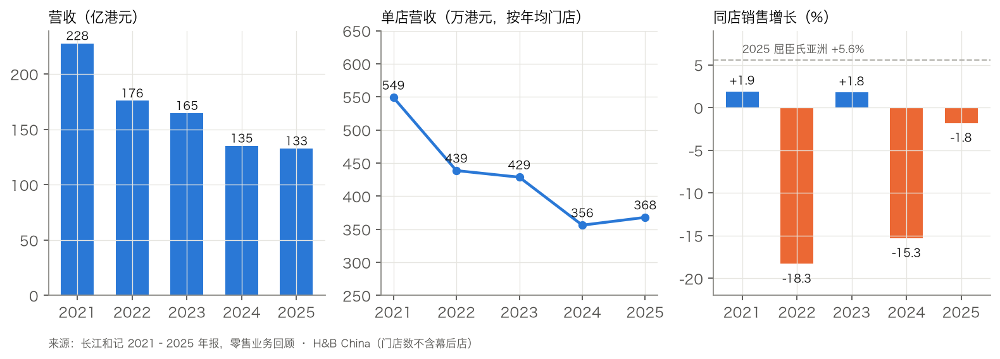
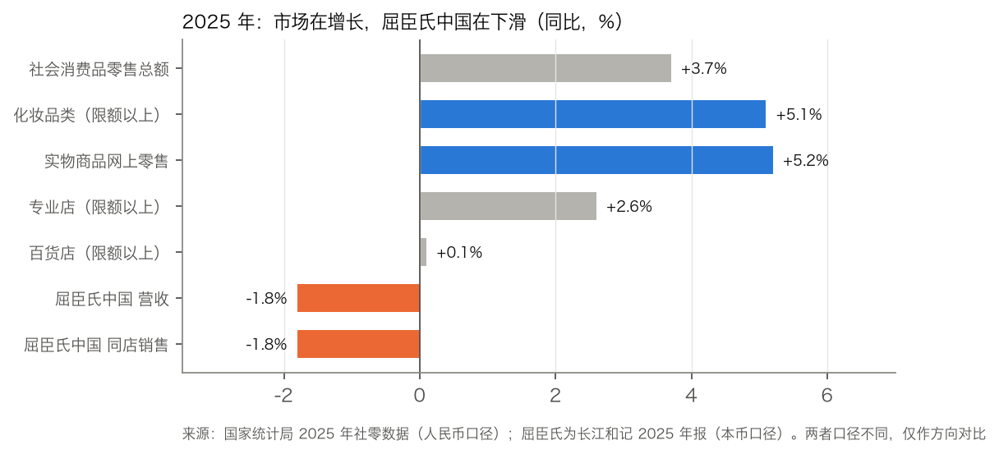
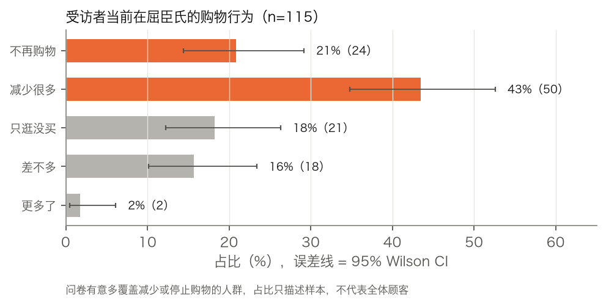
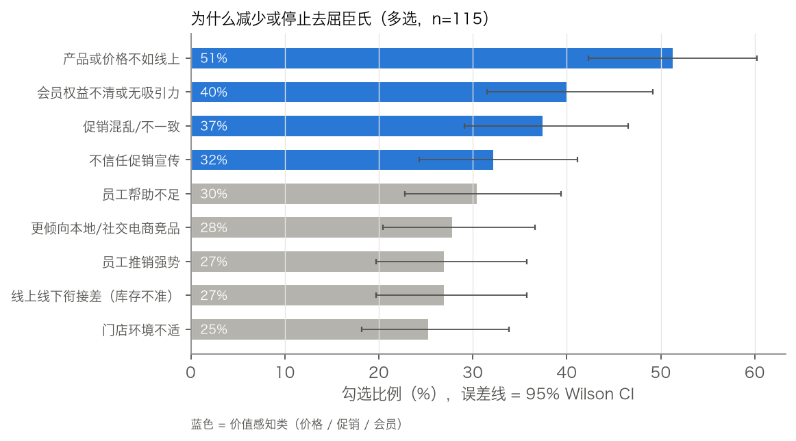
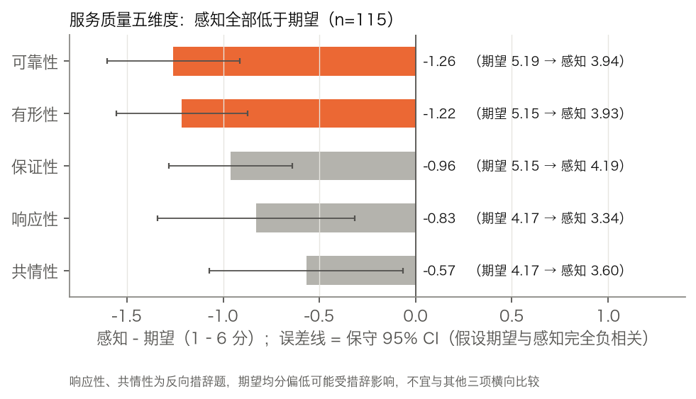

# 屈臣氏中国增长诊断：门店为什么卖不动了，增长从哪里回来

**结合年报、国家统计局数据和 115 份消费者问卷，从用户痛点推导业务杠杆，并提出可通过试点验证的增长方向**

---

## 摘要

屈臣氏中国 2021–2025 年营收从 227.7 亿港元降至 132.7 亿港元，下降 42%；EBITDA 率从 11.6% 降到 0.9%。2025 年，国内限额以上化妆品类零售额增长 5.1%，屈臣氏集团 H&B 其他三个区域的同店销售也都是正增长。本报告想回答三个问题：

- 问题出在哪个环节？
- 顾客为什么离开？
- 增长应该从哪里找回来？

**五个核心发现**

1. **主要问题是单店效率，关店只是次要因素。** 营收降幅中约 74% 来自单店营收下滑，门店数减少只解释约 26%。2025 年，中国区门店占集团零售门店的 20%，收入只占 6%，是集团零售各业务单元中唯一同店下滑的。
2. **化妆品品类需求仍在增长，下滑不能只归因于整体消费疲软。** 化妆品类零售额 +5.1%，跑赢社零整体（+3.7%）；线下的专业店只增长 2.6%，百货店只增长 0.1%。同类公司莎莎在公告中把退出内地线下的原因归为"中国内地零售市场以线上为主"。
3. **"产品或价格不如线上"是被勾选最多的流失原因。** 115 名到过门店的受访者中，51% 把它列为减少或停止购物的原因之一，排名第一。前四位原因都和价值感知有关（产品与价格、会员、促销）。
4. **服务体验缺口集中在"兑现承诺"和"门店本身"。** 服务质量五个维度的感知都低于期望，缺口最大的是可靠性（−1.26）和有形性（−1.22）。即使采用最保守的统计假设，这两个缺口仍然显著。
5. **建议三个增长方向**：价格心智修复、门店去推销化、门店即前置仓。以 2025 年营收为基数，同店增长率每提高 1 个百分点，约对应 1.33 亿港元营收。每个方向都配一个随机对照试点（A、B 以门店为单位，C 以城市为单位），实际能提升多少由试点测量。

---

## 一、研究设计

| 数据层 | 来源 | 用途 | 可信度规则 |
|---|---|---|---|
| 公司经营数据 | 长江和记 2021–2025 年报、2025 中期报告《零售业务回顾》 | 营收、门店、同店销售、利润、幕后店 | 只用原文数字；没有官方披露的指标一律不用 |
| 市场数据 | 国家统计局 2025 年社会消费品零售数据 | 行业增速、渠道与零售业态 | 官方统计 |
| 竞争动态 | 竞争对手公告；没有公告时以媒体报道补充 | 业态变化 | 正文中标明来源类型 |
| 消费者问卷 | SERVQUAL 问卷，回收 154 份，有效 115 份（到过屈臣氏门店的受访者） | 痛点排序、服务质量缺口 | 正文只用单题分布；跨题联合分析放在附录 |
| 一线机制 | 屈臣氏公开招聘 JD、媒体援引的员工自述、行政处罚报道 | 提出机制假设 | 只作定性线索，不引用未经核实的数字 |

**问卷设计**

- **服务质量量表**：在 SERVQUAL 原量表基础上改编，共 5 个维度、22 题。每题成对测量"期望"（优秀门店应该怎样）和"感知"（屈臣氏实际怎样），用 6 点 Likert 量表。响应性、共情性两个维度的 9 题采用反向措辞，用来识别敷衍作答。
- **流失原因**：多选题，9 个选项加开放回答。
- **投放**：通过问卷星投放，目标人群是到过中国大陆屈臣氏门店的消费者，有意多覆盖已经减少或停止购物的人。

---

## 二、业务诊断：问题出在单店效率



| 指标 | 2021 | 2022 | 2023 | 2024 | 2025 |
|---|---|---|---|---|---|
| 营收（亿港元） | 227.7 | 175.8 | 164.5 | 135.1 | 132.7 |
| 年末门店数 | 4,179 | 3,836 | 3,840 | 3,744 | 3,465 |
| 单店营收（万港元，按年均门店数） | 549 | 439 | 429 | 356 | 368 |
| 同店销售增长 | +1.9% | −18.3% | +1.8% | −15.3% | −1.8% |
| EBITDA（亿港元） | 26.4 | 10.9 | 10.4 | 4.7 | 1.2 |
| EBITDA 率 | 11.6% | 6.2% | 6.3% | 3.5% | 0.9% |

*来源：长江和记年报。门店数均不含幕后店：幕后店从 2024 年下半年才开始运营，所以 2021–2023 年的原口径不受影响；2024 年采用 2025 年报的重述口径 3,744 家（2024 年报原口径为 3,875 家，两者差额 131 家就是幕后店数量）。*

### 1. 营收降幅的约 3/4 来自单店

| 2021→2025 | 变化 | 占营收降幅的比重 |
|---|---|---|
| 营收 | −41.7% | 100% |
| 年均门店数 | −13.1% | 约 26% |
| 单店营收 | −33.0% | 约 74% |

*口径：营收 = 年均门店数 × 单店营收，按对数分解。*

关店是公司主动做的。中期报告原文写的是"close stores in low-traffic locations upon lease expiry"（在客流低的门店租约到期时关店）。更大的问题在于，留下来的门店卖得越来越少。

### 2. 2025 年单店营收小幅回升，但存量门店还没有好转

单店营收从 356 万港元回到 368 万港元（+3%），但同店销售仍是 −1.8%（上半年 −1.0%）。回升可能有两个来源：关掉了低效门店，或者营收中计入了由幕后店履约的线上订单。现有披露无法把两者拆开。

### 3. 和集团其他区域相比，差距很明显

| 2025 年 | 同店销售 | 单店营收（万港元） | EBITDA 率 |
|---|---|---|---|
| 屈臣氏中国 | −1.8% | 368 | 0.9% |
| 屈臣氏亚洲（不含中国内地） | +5.6% | 960 | 9.9% |
| 屈臣氏东欧 | +4.1% | 1,095 | 12.4% |
| 屈臣氏西欧 | +3.9% | 1,721 | 9.9% |
| 其他零售（百佳、丰泽等） | +3.9% | — | — |

*来源：长江和记 2025 年报。各区域门店面积和业态不同，单店营收只能看量级，不宜直接比较。*

中国区门店占集团零售门店的 20%（3,465 / 17,114），收入只占集团零售收入的 6%（132.65 / 2,092.67 亿港元）。

> **增长从哪里来**：门店营收 = 门店数 × 进店客流 × 转化率 × 客单价 × 购买频次。门店数正在主动收缩，所以增长主要只能来自两处：一是同店销售（公式的后四项），二是依托门店和幕后店做的线上履约。

---

## 三、市场与竞争：品类需求仍在增长，线下增速相对落后



| 2025 年同比 | 增速 | 来源 |
|---|---|---|
| 社会消费品零售总额 | +3.7% | 国家统计局 |
| 限额以上化妆品类零售额（4,653 亿元） | +5.1% | 国家统计局 |
| 实物商品网上零售额（占社零 26.1%） | +5.2% | 国家统计局 |
| 限额以上便利店 / 超市 / 专业店 / 百货店 / 品牌专卖店 | +5.5% / +4.3% / +2.6% / +0.1% / −0.6% | 国家统计局 |
| 屈臣氏中国营收 / 同店销售 | −1.8% / −1.8% | 长江和记年报 |

*统计局数字是限额以上单位的化妆品类零售额，不限渠道，也不限于老店；屈臣氏同店销售只看老店，且覆盖门店全部品类。两者口径不同，只用来比较方向，不能直接相减。*

**从这组数据能读出三点：**

- **品类需求仍在增长。** 化妆品类增速高于社零整体，所以屈臣氏的下滑不能只归因于整体消费疲软。这是 2025 年单年的对比，也不是同口径的份额数据，所以不能完全排除需求因素，屈臣氏是否丢失份额，现有数据无法确认。
- **渠道在迁移。** 网上零售保持增长；在线下业态里，离消费者近、主打即时便利的便利店增长最快，百货基本停滞。屈臣氏在统计口径上最接近专业店，而专业店只增长 2.6%。
- **同类公司在撤出线下。** 莎莎 2025/26 年度业绩公告写道："由于中国内地零售市场以线上为主，集团已在 2025 年 6 月 30 日前关闭所有线下店铺。"万宁也在 2025 年 12 月宣布退出内地，实体店于 2026 年 1 月中旬后停业。（万宁信息来自 TVB 新闻报道，未找到 DFI 官方原文。）

**屈臣氏可以利用的资产**：

- 2025 年末，内地 500 多个城市共 3,465 家门店；
- 2025 年 6 月末有 394 家幕后店（只处理线上订单的小型前置仓）。2024 年末只有 131 家，半年增加到约 3 倍。

中期报告把方向写为"adding dark stores to further enhance the online business capabilities"（增加幕后店以加强线上业务能力）。

---

## 四、用户洞察：顾客为什么离开

### 4.1 样本



115 名有效受访者中：

- 减少很多：43%（95% CI 35–53%）
- 不再购物：21%（14–29%）

问卷本来就有意多覆盖流失人群，所以这些比例只能描述样本，不能用来推断屈臣氏全体顾客的流失率。这份样本的价值在于帮助理解流失人群在意什么。

### 4.2 流失原因：产品与价格排第一



| 原因（多选） | 勾选人数 | 勾选比例 | 95% CI |
|---|---|---|---|
| 产品或价格不如线上 | 59 | 51% | 42–60% |
| 会员权益不清或无吸引力 | 46 | 40% | 32–49% |
| 促销混乱/不一致 | 43 | 37% | 29–47% |
| 不信任促销宣传 | 37 | 32% | 24–41% |
| 员工帮助不足 | 35 | 30% | 23–39% |
| 更倾向本地/社交电商竞品 | 32 | 28% | 21–37% |
| 员工推销强势 | 31 | 27% | 20–36% |
| 线上线下衔接差（库存不准） | 31 | 27% | 20–36% |
| 门店环境不适 | 29 | 25% | 18–34% |
| 其他（开放回答） | 23 | 20% | 14–28% |

*比例以 115 名有效受访者为分母。"产品或价格不如线上"的英文题干是"Products or prices were less attractive than online alternatives"，中文题干只写了"产品不如线上选择有吸引力"，所以这一项同时包含产品和价格两层意思。*

**怎么读这张表：**

- **第一位是确定的。** "产品或价格不如线上"的置信区间下限（42%）高于第四名及之后所有原因的上限。两个区间不重叠时，无论两项之间的相关性如何，差异都成立，所以这个判断不依赖个体数据。
- **其余原因之间的差异不显著。** 它和会员、促销混乱的区间有重叠；价值类原因和服务类原因（如员工帮助不足）之间也没有显著差异。
- **开放回答支持同一方向。** 例如"relatively expensive"和"same thing but cheaper prices"。

### 4.3 服务质量：感知全面低于期望，缺口集中在兑现承诺和门店本身



| 维度（题目内容） | 期望 | 感知 | 差距 | 保守 95% CI | 最坏情况检验 |
|---|---|---|---|---|---|
| 可靠性（承诺兑现、问题处理、交易与会员记录准确） | 5.19 | 3.94 | −1.26 | −1.60 ~ −0.91 | p<0.001 |
| 有形性（设备、设施、员工仪表、外观匹配） | 5.15 | 3.93 | −1.22 | −1.56 ~ −0.87 | p<0.001 |
| 保证性（信任员工、交易安全、礼貌） | 5.15 | 4.19 | −0.96 | −1.28 ~ −0.64 | p<0.001 |
| 响应性 | 4.17 | 3.34 | −0.83 | −1.34 ~ −0.32 | p=0.002 |
| 共情性 | 4.17 | 3.60 | −0.57 | −1.07 ~ −0.06 | p=0.03 |

**稳健性说明**：配对检验本来需要知道每个人的期望和感知如何相关。这里采用对检验最不利的假设，即两者完全负相关，并用条目标准差的平均值作为维度标准差的上界。在这个假设下，五个维度的缺口仍然全部显著，所以结论只用到了单题统计量。

**两点解读：**

- 可靠性和有形性的缺口只差 0.04，应该看作**并列最大**。保证性（信任、礼貌）的感知分是五个维度里最高的。
- 响应性和共情性的期望均分（4.17）明显低于其他维度（5.1–5.2），而这两个维度恰好都用了反向措辞。这种差异可能是措辞造成的，所以这两个维度的缺口不宜和其他三项直接比大小。

---

## 五、驱动树：把用户痛点对应到业务杠杆

```
同店销售 ─┬─ 进店客流 ◄── 推销压力（27%）· 门店有形性（−1.22）· 环境不适（25%）
          ├─ 转化率   ◄── 产品或价格不如线上（51%）· 促销混乱/不信任（37% / 32%）· 库存不准（27%）
          ├─ 客单价   ◄── 导购咨询能力（帮助不足 30%）
          └─ 购买频次 ◄── 会员权益不清（40%）· 倾向线上与社交电商（28%）
线上履约 ─── 门店与幕后店网络
```

| 痛点 | 杠杆 | 用户证据 | 外部证据 | 证据强度 |
|---|---|---|---|---|
| 产品与价格、促销 | 转化、频次 | 排名第一，置信区间下限 42%；促销两项分别为 37%、32% | 同类公司把退出线下归因于"市场以线上为主"（渠道层面）；年报提到中国区存在毛利压力（公司层面） | 中强（用户侧强，外部侧间接） |
| 会员权益 | 频次 | 40%（32–49%） | 黑猫投诉中有付费会员卡纠纷的公开案例；中国区会员数据没有单独披露 | 中 |
| 推销压力、帮助不足 | 客流、停留时长 | 27%、30% | 一条公开招聘 JD 和媒体援引的员工自述（见第六节） | 中弱 |
| 线上线下衔接 | 转化（缺货导致流失） | 27% | 公司正在扩建幕后店，说明在加码线上履约；门店库存准确性没有外部证据 | 中弱 |
| 门店有形性 | 客流 | 缺口 −1.22 | 没有外部量化证据 | 中（只有问卷一个来源） |

---

## 六、可能的机制：一线激励与推销压力

"推销强势"和"帮助不足"表面上是服务态度问题。现有线索提示，背后可能有激励机制的原因。**以下是待验证的假设，不是已证实的结论。**

| 线索 | 内容 | 来源类型 |
|---|---|---|
| 薪酬结构 | 一条屈臣氏美容岗位的公开 JD（发布日期未显示）：月度薪酬由"无责底薪 + 全勤奖 + 团队目标奖 + 个人直提奖金 + 套盒服务手工费 + TOP BA 津贴"构成，岗位要求理解"销售目标及重点产品"并"积极参与销售推动" | 公开招聘 JD（单条） |
| 考核指标 | 2023 年一篇报道援引前员工的公开说法，称门店 KPI 繁多，涉及客单价、自有品牌销售占比、客流转化率等；文章认为这是店员对顾客态度冷热不一的根本原因 | 媒体援引员工自述，未经核实 |
| 外部约束 | 2022 年、2023 年的报道显示，有地方市场监管部门就虚构原价促销、虚假宣传对屈臣氏作出行政处罚 | 媒体援引处罚决定书 |

**假设链**：个人提成和重点品指标 → 导购主动推销、推卡 → 顾客感到压力，减少进店，转向线上比价 → 客流和转化下降 → 门店指标压力更大。

需要说明两点：

- 这条 JD 里同时有团队目标奖，说明激励结构并不只有个人提成；
- 这条链路能否成立、影响有多大，需要用方向 B 的试点来检验。

---

## 七、增长方向与优先级

### 7.1 三个方向

**A. 价格心智修复**（目标杠杆：转化率、购买频次）

- 核心标品的价格带与品牌官方线上店对齐，不追求全面最低价；
- 价签直接标出会员价；
- 取消多重叠券式的复杂促销；
- 店内公示免费会员和付费会员卡的权益对比，办卡完全自愿。

**B. 门店去推销化**（目标杠杆：客流、停留时长、客单价）

- 导购考核从"个人销售额 + 重点品"调整为"门店转化率 + 复购率 + 顾客满意度"，提高团队奖金的比重；
- 设置"自助逛店"标识，顾客示意后导购再上前；
- 导购的角色从推销转向肌肤咨询。

**C. 门店即前置仓**（目标杠杆：线上增量、减少缺货流失）

- 门店库存实时接入即时零售平台；配送半径和时效作为试点的设计参数，暂不预设；
- "线上下单、门店自提"要保证库存准确；
- 门店和幕后店网络统一调度。

### 7.2 机会刻度

目前没有直接证据可以判断每个方向能把同店销售提升多少，所以本报告不做预设。下面只用年报数据给出刻度和参照：试点测出实际提升的百分点后，乘以刻度，就是该方向的营收规模。

| 参照 | 同店增长率 | 相对 2025 年实际（−1.8%）的提升 | 对应营收增量 |
|---|---|---|---|
| 刻度 | — | 每 +1.0 个百分点 | 约 1.33 亿港元 |
| 屈臣氏中国 2023 年水平 | +1.8% | +3.6 个百分点 | 约 4.78 亿港元 |
| 屈臣氏西欧 2025 年水平 | +3.9% | +5.7 个百分点 | 约 7.56 亿港元 |
| 屈臣氏亚洲 2025 年水平 | +5.6% | +7.4 个百分点 | 约 9.82 亿港元 |

*以 2025 年全部营收 132.65 亿港元近似可比门店营收。表中是营收，不是利润，不能和 EBITDA 直接比较。*

### 7.3 优先级

| | 影响面 | 可行性 | 证据强度 | 成本与难度 | 排序 |
|---|---|---|---|---|---|
| **A 价格心智修复** | 高：直接对应排名第一的流失原因和两项促销原因 | 中：价格对齐可能压缩毛利，需要和品牌方谈判 | 中强 | 中：直接成本低，主要风险在毛利 | **1** |
| **B 门店去推销化** | 中：对应推销和帮助两类痛点 | 中高：不需要资本投入，但涉及薪酬制度，一线会有阻力 | 中弱，需要试点检验机制假设 | 低至中：属于组织变革，见效慢 | **2** |
| **C 门店即前置仓** | 中：带来线上增量，减少缺货流失 | 中：需要系统对接和库存准确率，已有幕后店基础 | 中弱 | 中至高：涉及系统、履约和平台佣金 | **3** |

*排序是按以上三个维度做的定性判断，不是量化打分。*

---

## 八、试点设计

| | A 价格透明 | B 去推销化 | C 门店即前置仓 |
|---|---|---|---|
| 分组方式 | 门店随机分组，同城配对 | 门店随机分组，新考核只在试点店实施 | 以城市或商圈为单位分组 |
| 时长 | 12 周 | 4 周适应期 + 12 周观察 | 12 周起；观察对线下销售的替代效应需要更长时间 |
| 主指标 | 同店销售增长、转化率（成交单数 / 进店客流） | 进店客流、转化率 | 门店线上订单量、缺货率 |
| 护栏指标 | **毛利率**、客单价 | 客单价、连带率、会员注册数 | 履约时效、试点店线下销售是否被替代 |
| 判定规则 | 同店销售显著提升，且毛利额不下降 | 客流和转化率提升，且客单价不下降 | 线上订单增量大于线下被替代的部分 |

**样本量按公式计算，参数不预设：**

> 每组门店数 n = 2 ×（z₀.₉₇₅ + z₀.₈）² × σ² ×（1 − ρ²）/ δ²

- **σ**：门店之间 12 周同店增长的标准差，用试点前 52 周的周销售数据估计。
- **ρ**：试点前后同店增长的相关系数，同样用历史数据估计。以试点前销售作为协变量（ANCOVA）时，ρ 越高，需要的门店越少。
- **δ**：业务方希望检出的最小提升幅度，可以参照 7.2 的刻度来定。

方向 C 以城市为单位分组，分组单位少，建议用双重差分，并适当延长观察期。

---

## 九、实施路线

| 阶段 | 动作 | 判断节点 |
|---|---|---|
| 0–6 个月 | 启动 A、B 试点（价签与促销规则；考核方案）。B 的直接成本低；A 的直接成本低，但要盯住毛利 | 12 周试点读数；毛利护栏 |
| 6–12 个月 | 推广 A、B 中有效的做法；启动 C 的城市级试点 | 推广后的门店能否保持试点效果 |
| 12–24 个月 | C 规模化，与幕后店统一调度；推进门店有形性改造（设备、设施、试用区） | 同店销售连续转正；线上与门店协同订单的占比 |

---

## 十、局限

- **问卷样本**：便利抽样，有意多覆盖流失人群，没有人口学题。10 条开放回答中有 9 条是英文，说明样本里有校内交换生；这 10 条来自问卷早期阶段的后台截图。因此问卷适合给痛点**排序**，不适合推算人群规模，也不能代表全体屈臣氏顾客。
- **个体数据**：115 份有效样本的个体数据是根据问卷星真实汇总分布重建的。正文只用单题分布（比例、均值、差距）；依赖同一受访者跨题作答的分析放在附录 A，只作方向性参考。
- **横截面与自报**：问卷只能说明痛点和流失同时存在，不能证明前者导致后者。这也是建议都落在随机对照试点上的原因。
- **未披露数据**：屈臣氏中国的线上收入占比、会员数和毛利率都没有单独披露，本报告不做估计。

---

## 附录 A　问卷跨题分析（方向性参考）

> 个体数据根据问卷星真实汇总分布重建。以下结果依赖同一受访者跨题作答，**只作方向性参考**。如果能拿到问卷星逐人导出的数据，会用同一套代码重跑。

**分群定义**（按当前购物行为）：

- 留存：购物频率差不多或更多了
- 观望：只逛不买
- 摇摆：减少很多
- 流失：不再购物

**结果：**

- 分群感知均分（1–6 分）：留存 3.98，观望 3.89，摇摆 3.79，流失 3.58。
- 分群 × 流失原因：流失人群勾选"产品或价格不如线上"的比例最高；观望人群更多勾选"线上线下衔接"和"环境"。
- 量表 Cronbach's α：感知 0.86–0.91，期望 0.28–0.59。这组数值来自重建数据，不能作为量表信度的证据。

**题目逻辑**：问卷没有记录流失原因题的跳题逻辑，以上比例都以全部 115 人为分母。没有减少购物的受访者本来就较少有"原因"可勾，所以各分群勾选数的差异有一部分来自题目设计，不能据此推论"流失是多重失望的累积"。

## 附录 B　来源

| 来源 | 链接 | 访问日期 |
|---|---|---|
| 长江和记 2025 年报《零售业务回顾》（第 25–29 页） | https://doc.irasia.com/listco/hk/ckh/annual/2025/en/orretail.pdf | 2026-10-25 |
| 长江和记 2024 / 2023 / 2021 年报《零售业务回顾》 | 同上路径，年份替换为 2024 / 2023 / 2021 | 2026-10-25 |
| 长江和记 2025 中期报告 | https://doc.irasia.com/listco/hk/ckh/interim/2025/CKHH_2025_InterimReport_e.pdf | 2026-10-25 |
| 国家统计局 2025 年社会消费品零售总额 | https://www.stats.gov.cn/xxgk/sjfb/zxfb2020/202601/t20260119_1962323.html | 2026-10-27 |
| 莎莎国际 2025/26 年度全年业绩新闻稿 | https://doc.irasia.com/listco/hk/sasa/annual/2026/screspress.pdf | 2026-10-27 |
| 万宁退出内地（TVB 新闻） | https://news.tvb.com/tc/1140203-Manningstoexitmainlandmarket | 2026-10-27 |
| 屈臣氏门店岗位 JD（智联招聘） | https://www.zhaopin.com/jobdetail/CC526959220J40899781415.htm | 2026-10-27 |
| 新熵《羊毛党困住屈臣氏》（界面新闻转载，2023-08） | https://www.jiemian.com/article/9974689.html | 2026-10-27 |
| 行政处罚相关报道（澎湃新闻 2022；中国经济网 2023） | https://m.thepaper.cn/newsDetail_forward_18372052 ；http://finance.ce.cn/stock/gsgdbd/202309/08/t20230908_38707707.shtml | 2026-10-27 |
| 黑猫投诉公开案例 | https://hb.tousu.sina.com.cn/complaint/view/17391666773/ | 2026-10-25 |

